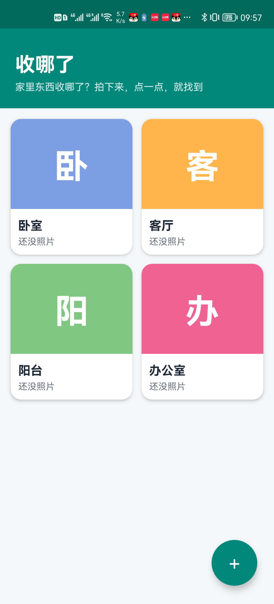
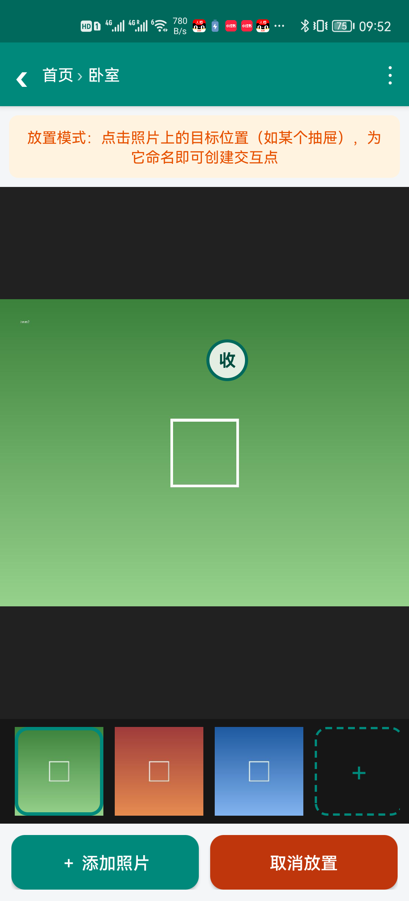

# 收哪了 — 家庭收纳位置记录 App（安卓）

通过「拍照 + 照片上的交互点」逐层记录家里柜子、抽屉、箱子的物品存放位置，
解决"东西收哪了"的遗忘问题。

**成品 APK**：`apk/收哪了-v1.1.apk`（已签名，无需任何权限）
**开源协议**：MIT（见 `LICENSE`）— 可自由使用、修改和分发，需保留版权声明

## 界面预览

| 首页：收纳空间一览 | 交互点：在照片上标记位置 |
|:---:|:---:|
|  |  |

## 功能

1. **首页**：收纳空间缩略图网格。预置「卧室 / 客厅 / 阳台 / 办公室」四个分类，
   均可重命名、删除；点右下角 ＋ 可**自定义创建**任意空间（名称随意起）。
   封面自动取该空间的第一张照片（可手动设为封面），无照片时显示彩色文字占位。

2. **无限层级钻取**：首页 → 阳台 → 柜子A → 抽屉 → 物品……没有层数限制。
   顶部面包屑显示完整路径，点击任意一段可直接跳回该层级；返回键逐级返回。

3. **交互点（核心）**：在当前层级的照片上点「◎ 添加交互点」，再点照片上的目标位置
   （如某个抽屉），命名即创建一个圆形标记。日常使用时点击圆点即可进入下一层级。
   长按圆点：打开 / 重命名 / 移除标记 / 删除子项。照片支持双指缩放、拖动、双击放大，
   交互点位置随缩放自动跟随。

4. **多图**：每个层级可上传多张照片（拍照或相册多选），例如进入最底层抽屉后
   一次选 10 张照片展示 10 件物品。底部缩略图条切换，长按缩略图可设为封面或删除。

5. **备注**：每个层级可添加文字备注（右上角 ⋮ → 编辑备注）。

6. **侧边栏（v1.1 新增）**：首页右上角 ☰（层级页 ⋮ 菜单内也有入口）
   - **备份与恢复**：导出全部数据为一个 zip（数据库 + 照片 + 缩略图），换手机时导入；
     走系统文件选择器，依然零权限
   - **设置**：恢复预置空间 / 清空全部数据并恢复初始状态
   - **关于与联系**：作者、邮箱 weizheng111@gmail.com、QQ 交流群二维码、
     赞助收款码、MIT 协议全文

## 数据存储与备份

- 数据保存在应用私有目录（SQLite + JPEG 文件），**不申请任何权限、不联网**，
  卸载应用即清除。
- 照片入库时自动压缩（长边 1600px）并按 EXIF 纠正方向，节省空间。
- **换手机**：旧手机 侧边栏 → 备份与恢复 → 导出备份（存到下载/网盘/微信）→
  新手机装好 APK 后导入备份即可。备份 zip 结构：`info.txt`（版本信息）+
  `nawle.db`（数据库）+ `images/` + `thumbs/`。

## 替换二维码 / 邮箱 / 作者名

发布前替换为自己的真实信息：

- QQ 群二维码：替换 `app/res/drawable-nodpi/qr_qq.png`（当前为占位图）
- 赞助收款码：替换 `app/res/drawable-nodpi/qr_donate.png`（当前为占位图）
- 邮箱 / 作者名：改 `app/src/com/nawle/app/About.java` 中的常量

改完重新 `bash build.sh` 即可。占位图可用 `scripts/GenQrPlaceholders.java` 重新生成。

## 安装

- **直接安装**：把 `apk/收哪了-v1.1.apk` 传到手机（微信/网盘/数据线均可），文件管理器
  点击打开，允许"安装未知来源应用"即可。要求 Android 5.0+。
- **adb 安装**：`adb install -r apk/收哪了-v1.1.apk`（手机需已授权 USB 调试）。

## 重新构建

无需 Android Studio / Gradle，构建工具链已放在 `toolchain/` 目录（build-tools 34 +
android-34 platform，来自腾讯镜像）。在 Git Bash 中执行：

```bash
bash build.sh
```

签名密钥为仓库内自签的 `debug.keystore`（密码 android），正式发布请更换自己的密钥。

## 工程结构

```
app/
  AndroidManifest.xml          清单（无任何权限声明）
  src/com/nawle/app/
    MainActivity.java          首页：空间网格 + 创建/重命名/删除 + 侧边栏入口
    NodeActivity.java          层级页：多图浏览 + 交互点 + 无限钻取
    AboutActivity.java         关于页：作者/联系方式/二维码/赞助/MIT 协议
    Sidebar.java               侧滑面板（备份/设置/关于）
    Backup.java                备份导出/导入（zip + SAF，零权限）
    About.java                 作者与联系方式常量（改这里换邮箱/作者名）
    InteractiveImageView.java  可缩放图片视图 + 交互点绘制与命中
    Store.java                 数据层（SQLite + 图片压缩/缩略图/级联删除）
    Db.java                    建表
    FilesProvider.java         供系统相机写入拍照结果
    Ui.java                    对话框/工具
  res/                         布局、主题、图标
  assets/license.txt           MIT 协议全文（关于页展示用）
scripts/GenIcons.java          启动图标生成器
scripts/GenQrPlaceholders.java QQ群/收款码占位图生成器
apk/                           成品 APK（构建脚本输出目录）
screenshots/                   应用截图
testimg/                       开发测试用示例照片
LICENSE                        MIT 协议
build.sh                       一键构建脚本
toolchain/                     构建工具链（aapt2/d8/zipalign/apksigner/android.jar）
```
